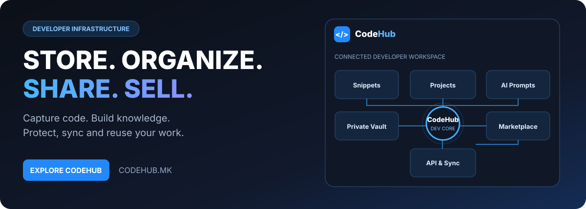

[Македонски](README.mk.md) · [English](README.md) · [Shqip](README.sq.md) · [Türkçe](README.tr.md)

# CodeHub.mk — платформа за програмери

[English](README.md) · [Официјална веб-страница](https://codehub.mk) · [PROCESS IN](https://processin.mk)

## Организирај го своето програмерско знаење

CodeHub.mk е платформа за чување и организација на code snippets, проекти, AI промптови и други технички ресурси. Наместо корисните решенија да се губат низ разговори и датотеки, тие остануваат организирани за повторна употреба.

## Процес

1. Зачувај код, AI промпт или проектен ресурс.
2. Организирај го според проект, категорија и ознаки.
3. Контролирај пристап до приватните материјали.
4. Пронајди и искористи постојно решение.
5. Сподели или објави соодветни ресурси.
6. Користи маркетплејс и наплата кога се овозможени.

## Функционалности

Code Snippets, проекти и колекции, AI Prompt Library, Private Vault, пребарување, интеграции, маркетплејс, претплати и продажба на дигитални програмерски ресурси.

## Подетално за функционалностите

### Библиотека со код

Зачувувај повторно употребливи делови од код, примери и технички решенија. Организирај ги според проект и категорија за полесно пребарување.

### Проекти и AI промптови

Поврзувај ги корисните ресурси со конкретни проекти. Создавај колекции од AI инструкции за развој, тестирање и решавање проблеми.

### Приватен трезор

Чувај избрани материјали како приватни ресурси и контролирај ја нивната видливост.

### Споделување и маркетплејс

Објавувај ресурси и истражувај ги достапните можности за продажба, согласно активната понуда и условите на платформата.

### Интеграции и наплата

Интеграциите, претплатите и платежните можности зависат од поддржаните конфигурации.

## За кого е наменет?

За програмери, развојни тимови, AI креатори и автори на технички материјали што сакаат да го зачуваат и повторно користат своето знаење.

**[Посети CodeHub.mk](https://codehub.mk)**

*Официјална презентација на PROCESS IN. Репозиториумот не објавува приватен код или кориснички ресурси.*
